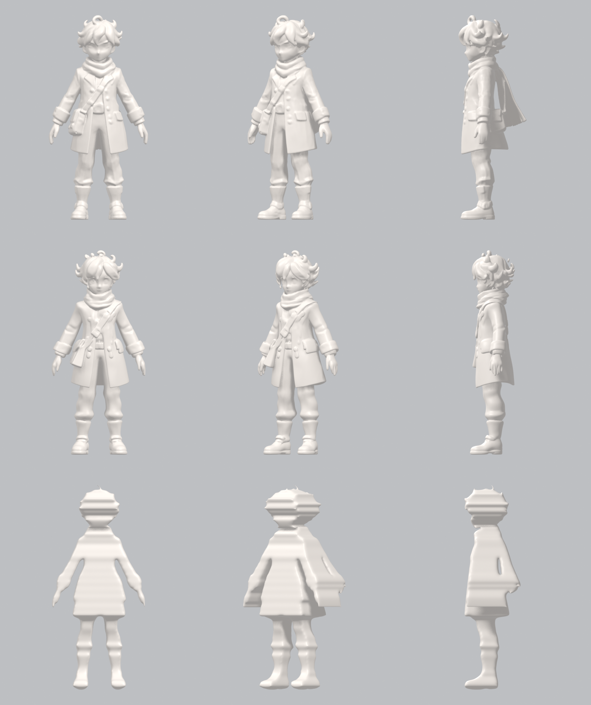
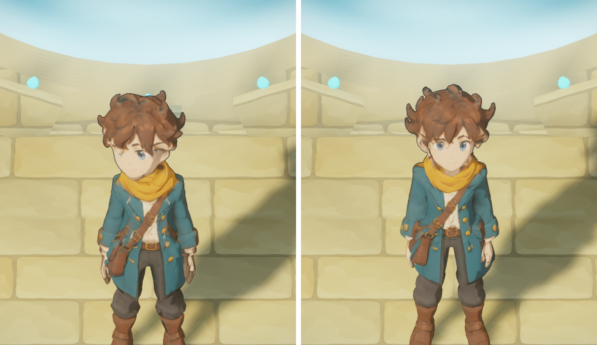

# Alternativas a Hunyuan3D para la forma de los personajes (ciclo 30, 14 oct 2026)

El usuario no quiere depender de terceros con licencias restrictivas. **No se publica nada hasta
resolverlo.** Lo hecho con Hunyuan3D se conserva.

## Qué hacía Hunyuan3D, y qué no

En el proceso de cada personaje, Hunyuan3D-2mv (Tencent) hacía **sólo la forma**: una malla sin
color, a partir del frente, el perfil y la espalda de la hoja de giro. Todo lo demás es nuestro:
la textura proyectada desde las referencias, la cara, las regiones de color, el esqueleto, las
animaciones y el kit de impresión (`scripts/blender/*.py`). Las referencias se generaron con la
herramienta de imágenes de ChatGPT/Codex. OpenAI le cede a quien las genera los derechos sobre lo
que produce.

**Licencia de Hunyuan3D 2.0 («Tencent Hunyuan 3D 2.0 Community License»):** no vale en la Unión
Europea, el Reino Unido ni Corea del Sur. Pide una licencia aparte por encima de cierta cantidad de
usuarios por mes y tiene una política de uso aceptable. Es gratuita, pero no es abierta.

## Opciones investigadas

| Opción | Licencia | ¿Corre en la Mac M2 de 16 GB? | Notas |
|---|---|---|---|
| **TripoSG** (VAST, la empresa de Tripo) | **MIT, código y pesos** | **Sí, adaptado (13 min por forma)** | Una sola imagen. Trae el recortador BRIA RMBG-1.4, **no comercial**: se reemplazó por rembg/u2net (Apache 2.0). Usa DINOv2 (Apache 2.0) |
| TripoSR (VAST + Stability) | MIT | Sí | Más viejo y bastante más tosco |
| TRELLIS.2 (Microsoft) | MIT (código y pesos) | No: pide NVIDIA de 24 GB; el puerto a Mac pide 24 GB de memoria | Depende de nvdiffrast (NVIDIA, licencia propia). Sólo alquilando una GPU |
| Step1X-3D (StepFun) | Apache 2.0 | No: 27 GB de GPU | Sólo alquilando una GPU |
| SAM 3D Objects (Meta) | SAM License (propia) | No: 32 GB de GPU | Devuelve nubes de puntos («splats»), no mallas limpias |
| Stable Fast 3D (Stability) | Comunitaria: gratis hasta USD 1 M de ingresos | Quizás | Licencia con tope |
| Meshy / Tripo (servicios web) | Plan pago: el usuario es dueño de lo generado. Plan gratis: CC BY 4.0 (hay que citar) o uso no comercial, según la fuente | Web | Costo mensual; leer las condiciones vigentes antes de usar |
| **Forma por siluetas** (propia, sin modelos) | Nuestra | Sí, en segundos | Queda como un bloque escalonado: sirve sólo como referencia |

Nada de esto lo revisó un abogado. Antes de vender algo, hay que leer las licencias vigentes.

## Prueba: el viajero con TripoSG

- `scripts/ia3d/forma_triposg.py`: TripoSG adaptado a la Mac. Usa el decodificador por cubos
  marchantes y no el de CUDA, prepara la imagen en la CPU y recorta el fondo con rembg. Los
  cambios al repositorio de TripoSG, en `~/code/ohmdal-3d/TripoSG`, son tres reemplazos de
  `cuda`: dispositivo y preparación de la imagen.
- `scripts/ia3d/forma_silueta.py`: la forma por siluetas, propia.
- `scripts/blender/vista-forma.py`: tres vistas en arcilla, con la misma luz, para comparar formas.
- La forma de TripoSG pasó por el mismo proceso de Blender: textura, cara, regiones y esqueleto.
  Pesa 1,3 MB, como el actual. Se ve con `?figura=tsg`.

**Resultado.** La forma de TripoSG está a la par de la de Hunyuan, y de cerca la cara se ve más
definida: ojos, cejas y sonrisa. Queda algo más delgada de perfil, porque lee una sola imagen y no
las tres. Las puntas del pelo salen más marcadas.
