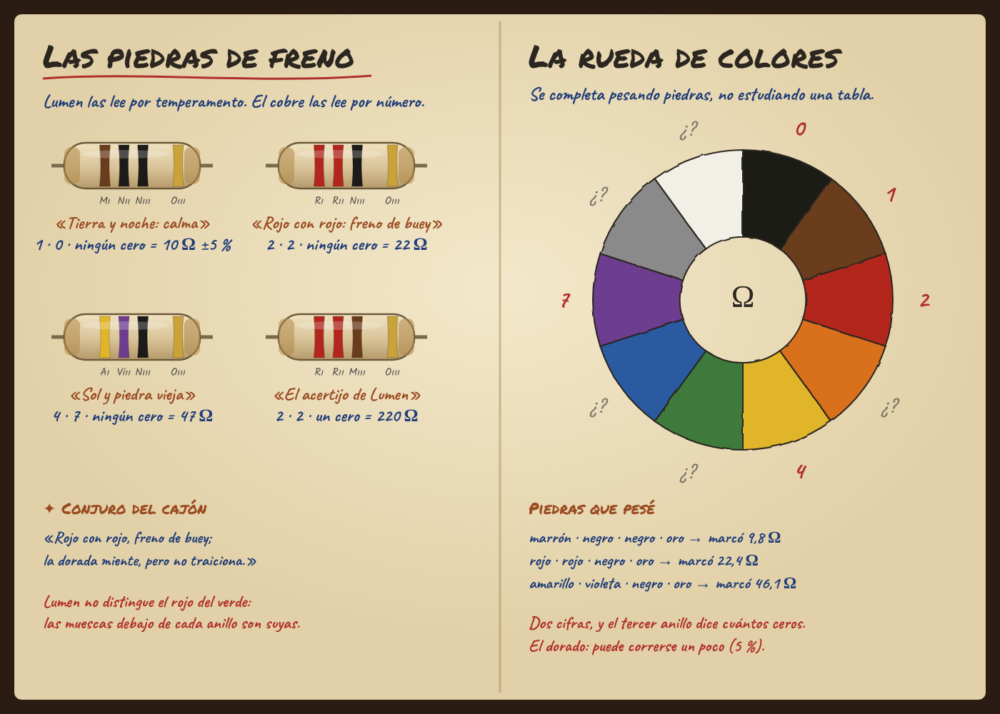

# Las piedras de freno · diseño para revisar

Propuesta del Ciclo 23 (10 oct 2026). **Aprobada y construida** (11 oct 2026): las tres decisiones de abajo salieron «sí». Diferencias con la propuesta: el zócalo vacío de la Calzada tiene un puente de cobre; la piedra vieja del Faro III es de 24 Ω; las marcas de Lumen muestran la inicial del color (sin muescas numéricas, que darían la cifra); el acertijo no ofrece «medir sin anotar».

## La idea en una línea

Los resistores de Ohmdal son **piedras de freno**: cápsulas de cerámica con anillos pintados. Los
herederos leen esos anillos como el **temperamento** de cada piedra. El jugador descubre, midiendo
y comparando, que los anillos son **un número escrito en colores**. Nadie lo obliga a memorizar
el código: lo deduce y lo deja escrito en la rueda de colores de su Bitácora.

## Lo que creen los herederos (el Oficio)

Lumen elige piedras «por temperamento» y tiene dichos para leerlas. Cada dicho esconde algo de
verdad:

| Anillo | El dicho del taller | Lo que es en realidad |
|---|---|---|
| Negro | «La noche no agrega nada» | 0, y como tercer anillo, ningún cero |
| Marrón | «Tierra: calma» | 1 |
| Rojo | «Fuego: frena fuerte» | 2 |
| Amarillo | «Sol» | 4 |
| Verde | «Hoja» | 5 |
| Violeta | «Raro, de las piedras viejas» | 7 |
| Oro | «La piedra dorada miente un poco» | Tolerancia ±5 %: el valor real puede correrse un poco |

Conjuro del cajón: **«Rojo con rojo, freno de buey; la dorada miente, pero no traiciona»**.

**Lumen no distingue el rojo del verde.** Por eso marcó cada piedra con muescas y por eso habla de
«temperamento»: las reconoce por el peso, el sonido y sus marcas. Esto le da al personaje un
detalle humano y resuelve la accesibilidad: el ajuste «Las marcas de Lumen» muestra, junto a cada
anillo, la inicial del color con sus muescas. Funciona para jugadores daltónicos y en impresión
en blanco y negro.

## Mecánica

### 1 · El cajón de Lumen (Taller, opcional, después de la primera reparación)

Un banco chico, sin encargo urgente:
- **Seis piedras** en una bandeja: 10, 12, 22, 47, 100 y 120 Ω, todas con anillo dorado.
- **Un instrumento nuevo, «Pesar el freno»** (el óhmetro): con la mesa apagada dice cuánto frena
  la piedra en ohmios. Mide 11,8 en vez de 12, porque la dorada «miente un poco».
- **Cada piedra pesada se copia en la Bitácora,** con sus anillos y su valor, en la página
  «La rueda de colores».
- **Después de tres piedras,** Ohm señala lo que el jugador ya puede ver: «Las de dos anillos
  marrón y negro, con negro o marrón al final: 10 y 100. El tercer anillo parece decir cuántos
  ceros».
- **El acertijo de Lumen:** una séptima piedra (rojo, rojo, marrón) que no se deja pesar hasta
  que el jugador diga cuánto frena. Elige entre 22, 220 y 2200 Ω. Es la misma mecánica que la
  marca esperada de Nereo, en boca de Lumen. Después se pesa y se confirma.
- **Lo que se aprende:** notación posicional, es decir, dos cifras y cuántos ceros, como los
  números de todos los días. También que un instrumento lee un valor con margen.

### 2 · El freno del cerrojo (Calzada, en el camino principal)

La perilla «Freno de la bobina» se reemplaza por **un zócalo y la bolsa de piedras de Edda**:
- **Piedras disponibles:** 10, 22, 47 y 100 Ω, más «sin piedra».
- **La física:** la bobina pasa a 14 Ω. Con la de 10 Ω pasan 0,50 A y el cerrojo queda firme;
  con la de 22 tiembla; sin piedra golpea.
- **Sin bloqueo:** quien no hizo el cajón de Lumen puede probar las piedras una por una y
  resolverlo igual. Quien sabe leer los anillos elige sin probar. La diferencia es de tiempo, no
  de acceso.
- **Lo que vio Ohm** suma una tarjeta: «Marrón, negro, negro: 1, 0 y ningún cero. Diez ohmios».

### 3 · Las piedras de repuesto de Nereo (Faro III)

El brazo superior del divisor, hoy una perilla, se reemplaza por **un zócalo y la caja de
repuestos del farero**:
- **Piedras disponibles:** 10, 12 y 15 Ω, todas doradas.
- **La física:** con la lente conectada, la de 12 Ω da 9 V en la toma, y sigue entre 8,8 y 9,2 V
  aunque «mienta» su 5 %. La de 10 da 9,8 V y la de 15, 8 V: fuera de la luz dorada.
- **Lo que se aprende:** para qué sirve la tolerancia. Nereo anota en el libro del farero
  «marrón, rojo, negro, oro», no «la tercera piedra de la caja».

## En la Bitácora

- **Página nueva «La rueda de colores»:** una rueda de diez colores dibujada a mano. Cada color
  se completa con su número recién cuando el jugador pesó una piedra que lo usa; los que faltan
  quedan con «¿?». Al lado, las piedras pesadas, cada una con sus anillos, su número y lo que
  marcó el instrumento. El jugador completa la rueda pesando piedras, no estudiando una tabla.
- **Palabras del oficio:** «Los anillos de las piedras» → «Código de colores · tolerancia».
- **En los esquemas:** la resistencia lleva sus anillos pintados encima del zigzag.

## Arte

- **Piedra:** cápsula de cerámica crema con extremos de bronce y cuatro anillos pintados a mano,
  con un borde imperfecto. Mide unos 90 × 34 px en el banco.
- **Zócalo:** dos bornes de bronce con un lecho de fieltro. La piedra elegida «encaja» con un clic.
- **Bolsas y cajas:** la bolsa de Edda (tela), la bandeja de Lumen (madera con muescas) y la caja
  del farero (latón).

## Alcance y costo

| Pieza | Trabajo |
|---|---|
| Componente «piedra» con anillos (banco, esquema, Bitácora) | Medio |
| Zócalo intercambiable (elegir piedra) en la Calzada y el Faro III | Medio: reemplaza dos perillas; ajustar el modelo, las pruebas y los textos de esos bancos |
| Instrumento «Pesar el freno» (óhmetro con número) | Bajo: reutiliza la prueba de continuidad |
| Cajón de Lumen (banco opcional, acertijo) | Medio |
| Página «La rueda de colores» y palabra del oficio | Bajo-medio |
| «Las marcas de Lumen» (accesibilidad) | Bajo |

## Para decidir

1. ¿El cajón de Lumen va en el camino principal u opcional? Propuesta: **opcional**. La Calzada
   se puede resolver probando piedras.
2. ¿Reemplazar las perillas de la Calzada y del Faro III por zócalos? Propuesta: **sí en ambos**.
   La Calzada introduce las piedras y el Faro III cierra con la tolerancia.
3. ¿Lumen daltónico? Propuesta: **sí**, porque da accesibilidad con sentido en la historia.
